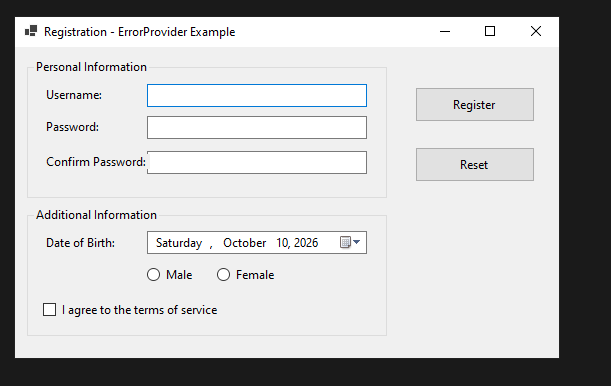
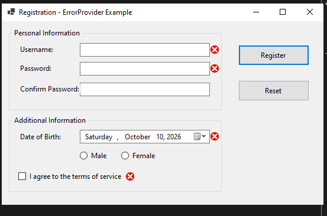
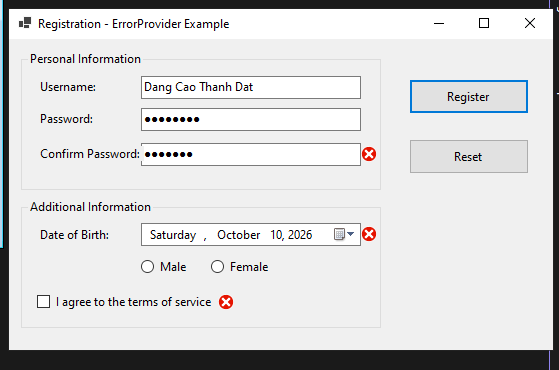
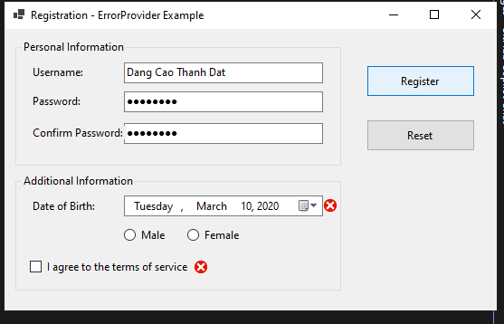
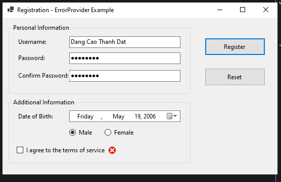
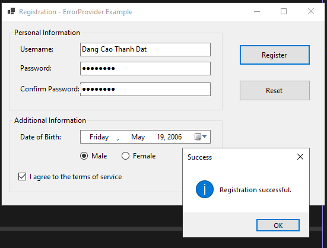

# BÁO CÁO BÀI TẬP

## THÔNG TIN SINH VIÊN
- **Họ và tên: Đặng Cao Thành Đạt**
- **Mã số sinh viên: 24810320215** 
- **Lớp: D19QTANM1** 
- **Tên môn học: Lập Trình.Net** 
- **Tên bài tập: BÀI 5.1: FORM ĐĂNG KÝ TÀI KHOẢN VÀ BẮT LỖI GIAO DIỆN
(ERRORPROVIDER)** 

---

## KẾT QUẢ THỰC HÀNH

### 1. Ảnh màn hình Giao diện chính

### 2.1 Tên đăng nhập và Mật khẩu không được để trống.

### 2.2 Mật khẩu nhập lại phải khớp với Mật khẩu ban đầu.

### 2.3 Độ tuổi tính từ Ngày sinh phải ≥ 18 tuổi.

### 2.4 Phải tích chọn đồng ý Điều khoản dịch vụ.

### 3. MessageBox thông báo thành công.
